# Syntaf School ERP — Rancangan Database & Relasi

## 1. Konfigurasi Database

| Aspek | Nilai |
|-------|-------|
| DBMS | MySQL 8.x |
| Charset | `utf8mb4` |
| Collation | `utf8mb4_unicode_ci` |
| Engine | InnoDB |
| Nama Database | `syntaf_school` |
| Naming Tabel | plural `snake_case` |
| Naming Kolom | `snake_case` |

> Semua tabel memiliki `id` (bigint auto increment), `created_at`, `updated_at`, dan `deleted_at` (soft delete) kecuali tabel pivot & tabel wilayah.

---

## 2. Kelompok Tabel (Domain)

```
1. AUTH & ACCESS      → users, roles, permissions, ...
2. MASTER DATA        → 41 tabel (lihat 02-PLAN-MASTER-DATA.md)
3. AKADEMIK           → classes, class_students, schedules, ...
4. KESISWAAN          → students, guardians, student_guardians, ...
5. KEPEGAWAIAN        → employees, employee_attendance, ...
6. KEUANGAN           → invoices, invoice_items, payments, savings, ...
7. PENILAIAN          → assessments, scores, report_cards, ...
8. ABSENSI            → student_attendances, ...
9. PERPUSTAKAAN       → books, book_loans, ...
10. INVENTARIS        → items, item_stocks, ...
11. PPDB              → registrations, ...
12. SISTEM            → activity_logs, notifications
```

---

## 3. Skema Inti (Core Tables)

### 3.1 Auth & Access

#### `users`
```
id, name, email (unique), password,
username (unique), phone, avatar_path,
userable_type, userable_id  -- polymorphic (Student/Employee)
email_verified_at, is_active, last_login_at,
remember_token, timestamps, deleted_at
```

#### `roles` (spatie)
```
id, name (unique), guard_name, timestamps
```

#### `permissions` (spatie)
```
id, name, guard_name, timestamps
-- unique(name, guard_name)
```

#### `model_has_roles` / `model_has_permissions` / `role_has_permissions`
Tabel pivot standar spatie/laravel-permission.

---

### 3.2 Akademik

#### `school_classes` (Kelas/Rombel)
```
id, school_id (FK), academic_year_id (FK),
education_level_id (FK), room_id (FK nullable),
name, code (unique), homeroom_teacher_id (FK employees nullable),
capacity, is_active, timestamps, deleted_at
```

#### `class_students` (Pivot siswa di kelas)
```
id, school_class_id (FK), student_id (FK),
academic_year_id (FK), status (enum: aktif/pindah/keluar),
timestamps
-- unique(student_id, academic_year_id)
```

#### `class_subjects` (Mapel per kelas + guru pengajar)
```
id, school_class_id (FK), subject_id (FK),
employee_id (FK employees), academic_year_id (FK), timestamps
```

#### `schedules` (Jadwal Pelajaran)
```
id, school_class_id (FK), subject_id (FK),
employee_id (FK), room_id (FK nullable), day_id (FK days),
start_time, end_time, semester_id (FK), timestamps
```

---

### 3.3 Kesiswaan

#### `students`
```
id, school_id (FK), nis (unique), nisn (nullable unique),
full_name, nick_name, gender_id (FK), religion_id (FK),
birth_place, birth_date, blood_type,
address, province_id, city_id, district_id, village_id, postal_code,
phone, email, photo_path,
residence_type_id (FK), transportation_id (FK),
child_order (anak ke-), sibling_count,
previous_school, admission_date, status_id (FK student_statuses),
is_active, timestamps, deleted_at
```

#### `guardians` (Orang Tua/Wali)
```
id, full_name, gender_id (FK), religion_id (FK),
address, phone, email, occupation_id (FK),
income_range_id (FK), education_background_id (FK),
timestamps, deleted_at
```

#### `student_guardians` (Pivot)
```
id, student_id (FK), guardian_id (FK),
guardian_relation_id (FK),
is_primary (boolean: wali utama), timestamps
```

#### `student_histories` (Riwayat kelas/mutasi)
```
id, student_id (FK), school_class_id (FK),
academic_year_id (FK), status, notes, timestamps
```

#### `student_violations`
```
id, student_id (FK), violation_type_id (FK),
date, description, point, reported_by (FK employees),
action_taken, timestamps
```

#### `student_achievements`
```
id, student_id (FK), achievement_type_id (FK),
title, date, level, rank, organizer, photo_path, timestamps
```

#### `student_extracurriculars`
```
id, student_id (FK), extracurricular_id (FK),
academic_year_id (FK), grade, timestamps
```

---

### 3.4 Kepegawaian

#### `employees`
```
id, school_id (FK), nip (unique nullable), nidn,
full_name, gender_id (FK), religion_id (FK),
birth_place, birth_date, address, phone, email,
photo_path, position (jabatan), employee_type (enum: guru/staf),
employment_status (enum: PNS/PPPK/Honorer),
join_date, is_teacher (boolean), is_active,
timestamps, deleted_at
```

#### `employee_attendances`
```
id, employee_id (FK), date, check_in, check_out,
attendance_status_id (FK), leave_type_id (FK nullable),
notes, timestamps
-- unique(employee_id, date)
```

#### `employee_positions` (Riwayat jabatan, opsional)
```
id, employee_id (FK), position, start_date, end_date, timestamps
```

---

### 3.5 Keuangan

#### `invoices` (Tagihan)
```
id, invoice_number (unique), student_id (FK),
academic_year_id (FK), fiscal_year_id (FK),
period (bulan/tahun), total_amount, discount_amount,
paid_amount, due_amount, status (enum: unpaid/partial/paid/overdue),
due_date, notes, timestamps, deleted_at
```

#### `invoice_items`
```
id, invoice_id (FK), fee_component_id (FK),
description, amount, quantity, subtotal, timestamps
```

#### `payments` (Pembayaran)
```
id, payment_number (unique), invoice_id (FK), student_id (FK),
payment_method_id (FK), bank_id (FK nullable),
amount, payment_date, reference_number,
proof_path, received_by (FK users), status,
timestamps, deleted_at
```

#### `savings` (Tabungan Siswa)
```
id, student_id (FK), type (enum: deposit/withdrawal),
amount, balance_after, transaction_date,
description, handled_by (FK users), timestamps
```

#### `student_discounts` (Diskon/Beasiswa per siswa)
```
id, student_id (FK), discount_type_id (FK),
value, start_date, end_date, is_active, timestamps
```

---

### 3.6 Penilaian

#### `assessments` (Penilaian/Ujian)
```
id, school_class_id (FK), subject_id (FK),
semester_id (FK), employee_id (FK),
name (Tugas/UTS/UAS/Praktik), type,
max_score, weight, date, timestamps
```

#### `scores`
```
id, assessment_id (FK), student_id (FK),
score, grade, notes, timestamps
-- unique(assessment_id, student_id)
```

#### `report_cards` (Rapor)
```
id, student_id (FK), school_class_id (FK),
semester_id (FK), academic_year_id (FK),
average_score, rank, attendance_summary (json),
notes, published_at, timestamps
```

---

### 3.7 Absensi Siswa

#### `student_attendances`
```
id, student_id (FK), school_class_id (FK),
date, attendance_status_id (FK), leave_type_id (FK nullable),
time_in, notes, recorded_by (FK employees),
timestamps
-- unique(student_id, date)
```

---

### 3.8 Perpustakaan

#### `books`
```
id, isbn (unique nullable), code (unique), title,
book_category_id (FK), publisher_id (FK nullable),
author_id (FK nullable), shelf_id (FK nullable),
publication_year, edition, language,
total_copies, available_copies, cover_path,
description, timestamps, deleted_at
```

#### `book_loans`
```
id, loan_code (unique), book_id (FK),
borrower_type (polymorphic: Student/Employee), borrower_id,
loan_date, due_date, return_date,
status (enum: borrowed/returned/overdue/lost),
fine_amount, notes, handled_by (FK users),
timestamps
```

---

### 3.9 Inventaris

#### `items`
```
id, code (unique), name, item_category_id (FK),
unit_id (FK), storage_location_id (FK nullable),
brand, model, purchase_date, purchase_price,
quantity, min_stock, condition (enum: baik/rusak ringan/rusak berat),
description, timestamps, deleted_at
```

#### `item_transactions` (Mutasi stok)
```
id, item_id (FK), type (enum: in/out/adjust),
quantity, date, reference, notes,
handled_by (FK users), timestamps
```

---

### 3.10 PPDB

#### `registrations` (Pendaftaran)
```
id, registration_number (unique), applicant_name,
gender_id (FK), religion_id (FK), birth_place, birth_date,
address, phone, email, parent_name, parent_phone,
previous_school, choice_level_id (FK),
documents (json), status (enum: draft/submitted/verified/accepted/rejected),
score, notes, timestamps, deleted_at
```

---

### 3.11 Sistem

#### `activity_logs` (spatie)
```
id, log_name, description, subject_type, subject_id,
causer_type, causer_id, properties (json), timestamps
```

#### `notifications` (Laravel)
```
id (uuid), type, notifiable_type, notifiable_id,
data (json), read_at, timestamps
```

#### `media` (spatie medialibrary, opsional)
```
id, model_type, model_id, uuid, collection_name,
file_name, mime_type, size, disk, conversions_disk,
manipulations (json), custom_properties (json), timestamps
```

---

## 4. Diagram Relasi (ERD Ringkas — Mermaid)

```mermaid
erDiagram
    SCHOOLS ||--o{ STUDENTS : has
    SCHOOLS ||--o{ EMPLOYEES : has
    SCHOOLS ||--o{ SCHOOL_CLASSES : has
    SCHOOLS }o--|| FOUNDATIONS : belongs_to

    ACADEMIC_YEARS ||--o{ SEMESTERS : has
    ACADEMIC_YEARS ||--o{ SCHOOL_CLASSES : has
    CURRICULA ||--o{ SUBJECTS : has
    EDUCATION_LEVELS ||--o{ SUBJECTS : has
    EDUCATION_LEVELS ||--o{ SCHOOL_CLASSES : has
    ROOMS ||--o{ SCHOOL_CLASSES : used_by

    SCHOOL_CLASSES ||--o{ CLASS_STUDENTS : contains
    STUDENTS ||--o{ CLASS_STUDENTS : enrolled_in
    SCHOOL_CLASSES ||--o{ CLASS_SUBJECTS : has
    SUBJECTS ||--o{ CLASS_SUBJECTS : in
    EMPLOYEES ||--o{ CLASS_SUBJECTS : teaches

    SCHOOL_CLASSES ||--o{ SCHEDULES : has
    SUBJECTS ||--o{ SCHEDULES : scheduled
    EMPLOYEES ||--o{ SCHEDULES : teaches
    DAYS ||--o{ SCHEDULES : on

    STUDENTS ||--o{ STUDENT_GUARDIANS : has
    GUARDIANS ||--o{ STUDENT_GUARDIANS : of
    GUARDIAN_RELATIONS ||--o{ STUDENT_GUARDIANS : type

    STUDENTS ||--o{ STUDENT_VIOLATIONS : has
    VIOLATION_TYPES ||--o{ STUDENT_VIOLATIONS : type
    STUDENTS ||--o{ STUDENT_ACHIEVEMENTS : has
    ACHIEVEMENT_TYPES ||--o{ STUDENT_ACHIEVEMENTS : type
    STUDENTS ||--o{ STUDENT_ATTENDANCES : has
    ATTENDANCE_STATUSES ||--o{ STUDENT_ATTENDANCES : status

    STUDENTS ||--o{ INVOICES : billed
    INVOICES ||--o{ INVOICE_ITEMS : contains
    FEE_COMPONENTS ||--o{ INVOICE_ITEMS : ref
    INVOICES ||--o{ PAYMENTS : paid_by
    PAYMENT_METHODS ||--o{ PAYMENTS : method
    BANKS ||--o{ PAYMENTS : via
    STUDENTS ||--o{ SAVINGS : owns
    STUDENTS ||--o{ STUDENT_DISCOUNTS : gets
    DISCOUNT_TYPES ||--o{ STUDENT_DISCOUNTS : type

    SCHOOL_CLASSES ||--o{ ASSESSMENTS : has
    SUBJECTS ||--o{ ASSESSMENTS : for
    SEMESTERS ||--o{ ASSESSMENTS : in
    ASSESSMENTS ||--o{ SCORES : graded
    STUDENTS ||--o{ SCORES : receives
    STUDENTS ||--o{ REPORT_CARDS : has

    BOOK_CATEGORIES ||--o{ BOOKS : categorize
    PUBLISHERS ||--o{ BOOKS : publishes
    BOOKS ||--o{ BOOK_LOANS : loaned

    ITEM_CATEGORIES ||--o{ ITEMS : categorize
    UNITS ||--o{ ITEMS : measured
    ITEMS ||--o{ ITEM_TRANSACTIONS : txn

    USERS ||--o{ ACTIVITY_LOGS : causer
    USERS }o--o| STUDENTS : userable
    USERS }o--o| EMPLOYEES : userable
```



---

## 5. Aturan Integritas & Relasi

### 5.1 Foreign Key Actions
| Relasi | On Delete | On Update |
|--------|-----------|-----------|
| Master → Transaksi | RESTRICT | CASCADE |
| Parent → Child (detail) | CASCADE | CASCADE |
| Pivot siswa-kelas | CASCADE | CASCADE |
| User → Activity Log | SET NULL | CASCADE |

### 5.2 Indexing Strategy
- **Primary:** semua `id`
- **Unique:** `nis`, `nisn`, `nis`, `email`, `invoice_number`, `payment_number`, `loan_code`, `code`
- **Composite Index:** `(student_id, academic_year_id)`, `(student_id, date)`, `(employee_id, date)`, `(assessment_id, student_id)`
- **Foreign Index:** otomatis dari FK
- **Search Index (FULLTEXT):** `students.full_name`, `books.title`

### 5.3 Soft Delete
Tabel berikut menggunakan soft delete (`deleted_at`):
`users`, `students`, `guardians`, `employees`, `school_classes`, `books`, `items`, `invoices`, `payments`, `registrations`, dan seluruh master data dengan `is_active`.

### 5.4 Polymorphic Relations
| Relasi | Kolom |
|--------|-------|
| User ↔ Student/Employee | `userable_type`, `userable_id` |
| Book Loan borrower | `borrower_type`, `borrower_id` |
| Activity Log subject | `subject_type`, `subject_id` |

---

## 6. Contoh Migration Laravel

```php
// database/migrations/xxxx_create_students_table.php
Schema::create('students', function (Blueprint $table) {
    $table->id();
    $table->foreignId('school_id')->constrained()->restrictOnDelete();
    $table->string('nis', 20)->unique();
    $table->string('nisn', 20)->nullable()->unique();
    $table->string('full_name', 150);
    $table->string('nick_name', 50)->nullable();
    $table->foreignId('gender_id')->constrained('genders')->restrictOnDelete();
    $table->foreignId('religion_id')->constrained('religions')->restrictOnDelete();
    $table->string('birth_place', 100)->nullable();
    $table->date('birth_date')->nullable();
    $table->string('blood_type', 5)->nullable();
    $table->text('address')->nullable();
    $table->string('province_id', 2)->nullable();
    $table->string('city_id', 4)->nullable();
    $table->string('district_id', 7)->nullable();
    $table->string('village_id', 10)->nullable();
    $table->string('postal_code', 10)->nullable();
    $table->string('phone', 20)->nullable();
    $table->string('email', 100)->nullable();
    $table->string('photo_path')->nullable();
    $table->foreignId('residence_type_id')->nullable()->constrained('residence_types')->nullOnDelete();
    $table->foreignId('transportation_id')->nullable()->constrained('transportations')->nullOnDelete();
    $table->tinyInteger('child_order')->nullable();
    $table->tinyInteger('sibling_count')->nullable();
    $table->string('previous_school', 150)->nullable();
    $table->date('admission_date')->nullable();
    $table->foreignId('status_id')->constrained('student_statuses')->restrictOnDelete();
    $table->boolean('is_active')->default(true);
    $table->timestamps();
    $table->softDeletes();
    $table->index(['student_id', 'academic_year_id']);
});
```

---

## 7. Seeder Prioritas

| Seeder | Isi |
|--------|-----|
| `RegionSeeder` | provinces, cities, districts, villages |
| `ReferenceSeeder` | religions, genders, occupations, education_backgrounds, dll |
| `AcademicSeeder` | curricula, education_levels, academic_years, semesters, days |
| `FinanceSeeder` | fee_components, payment_methods, banks, fiscal_years |
| `SystemSeeder` | settings, document_sequences |
| `RolePermissionSeeder` | roles, permissions, assign |
| `SchoolSeeder` | data sekolah default |
| `UserSeeder` | super admin default |

---

## 8. Dokumen Terkait

- [`01-PLAN-UTAMA.md`](./01-PLAN-UTAMA.md) — Rencana utama proyek
- [`02-PLAN-MASTER-DATA.md`](./02-PLAN-MASTER-DATA.md) — Rencana Master Data
- [`04-SPESIFIKASI-API-FRONTEND.md`](./04-SPESIFIKASI-API-FRONTEND.md) — API & struktur frontend
